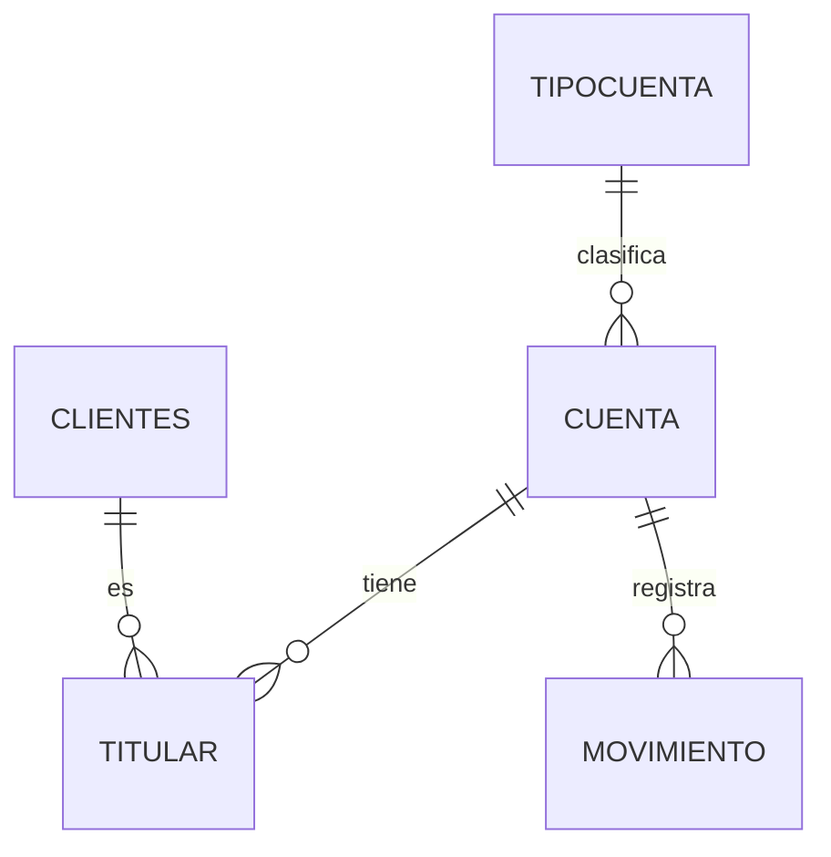

# Banco Demo – Sistema de Gestión Bancaria

Aplicación web académica para gestionar clientes, cuentas bancarias y operaciones (depósitos, retiros y transferencias), con consulta de DNI mediante una API externa y envío de confirmaciones por correo Gmail.

## Tecnologías utilizadas

| Capa | Tecnología |
|---|---|
| Lenguaje | Java 17+ |
| Framework | Spring Boot 3.5 |
| Seguridad | Spring Security (login por formulario, sesión, BCrypt, rol único `ADMIN`) |
| Persistencia | Spring Data JPA / Hibernate |
| Base de datos | MySQL / MariaDB (XAMPP) |
| Vistas | Thymeleaf + Thymeleaf Extras Spring Security |
| Diseño | Bootstrap 5.3 y Bootstrap Icons (por CDN, sin CSS propio) |
| Validación | Jakarta Bean Validation |
| Correo | Spring Mail (SMTP de Gmail) |
| API externa | apiperu.dev (consulta de DNI) con `RestTemplate` |
| Front dinámico | JavaScript nativo (`fetch`), sin React |
| Construcción | Maven |

## Funcionalidades

| Página | Descripción |
|---|---|
| Login | Acceso con Spring Security |
| Clientes | Listado, búsqueda por DNI y por nombre, edición, acceso a sus cuentas |
| Registro de cliente | Botón "Consultar DNI" que consume la API externa y completa los nombres |
| Apertura de cuenta | Selección de tipo, depósito inicial, clave de 4 dígitos y cotitulares (cuenta mancomunada) |
| Consulta de cuentas | Titulares, tipo, moneda, saldo, estado y fecha de apertura |
| Depósito | Registra un movimiento tipo `D` |
| Retiro | Exige la clave de la cuenta y saldo suficiente (movimiento tipo `R`) |
| Transferencia | Entre cuentas de la misma moneda |
| Movimientos | Historial de una cuenta con saldo anterior y posterior |
| Reportes | Clientes, cuentas, totales por moneda, cuentas por tipo y movimientos por rango de fechas |

## Reglas de negocio

- **Apertura de cuenta transaccional:** el registro de la cuenta, el primer movimiento (depósito inicial) y la actualización del saldo se ejecutan en una sola transacción (`@Transactional`). Si algo falla, no queda una cuenta sin su depósito.
- **Clave de cuenta:** se guarda cifrada con BCrypt. Tres claves incorrectas bloquean la cuenta.
- **Concurrencia:** las operaciones bloquean la fila de la cuenta (`PESSIMISTIC_WRITE`) y las transferencias bloquean las dos cuentas siempre en el mismo orden para evitar bloqueos mutuos.
- **Transferencias:** se registran como un retiro y un depósito enlazados por una referencia común.
- **Correos:** se envían después de confirmar la transacción (`AFTER_COMMIT`) y en segundo plano. Si la operación se revierte no sale correo, y si Gmail falla no se deshace la operación.

Correos enviados: registro de cliente, apertura de cuenta, depósito, retiro y transferencia (al origen y al destino).

## Modelo de datos



Tablas: `usuario`, `clientes`, `tipocuenta`, `cuenta`, `titular`, `movimiento`. El script completo con datos de prueba está en `database/banco_v2.sql`.

## Estructura del proyecto

```
banco-app/
├── database/
│   └── banco_v2.sql                 Script de la base de datos (estructura y datos de prueba)
├── src/main/java/com/banco/
│   ├── BancoApplication.java        Clase principal
│   ├── config/                      SecurityConfig, DataInitializer
│   ├── controller/                  Controladores de páginas y API REST interna (/api/**)
│   ├── dto/                         Formularios y objetos de transferencia
│   ├── entity/                      Entidades JPA
│   ├── event/                       Evento de notificación por correo
│   ├── exception/                   NegocioException
│   ├── repository/                  Repositorios Spring Data
│   └── service/                     Reglas de negocio, API de DNI y correos
├── src/main/resources/
│   ├── application.properties      Configuración (sin claves reales)
│   ├── static/js/                  Scripts de las páginas
│   └── templates/                  Páginas Thymeleaf (+ fragments/layout.html)
└── pom.xml
```

## Cómo funciona

1. El personal inicia sesión (Spring Security valida contra la tabla `usuario`, con contraseñas BCrypt).
2. En el registro de un cliente, el botón "Consultar DNI" llama con `fetch` a `/api/dni/{dni}`. El servidor consulta la API externa y devuelve los nombres; el token de la API nunca llega al navegador.
3. La apertura de cuenta valida los datos, genera el número de cuenta, guarda la clave cifrada, registra el depósito inicial y actualiza el saldo, todo en una transacción.
4. Depósitos, retiros y transferencias registran cada movimiento con saldo anterior y posterior y publican un evento; un listener envía el correo después del commit.
5. Las páginas usan Thymeleaf en el servidor y pequeños scripts para las búsquedas sin recargar (cliente, cuenta, DNI).

## Requisitos

- JDK 17 o superior
- MySQL o MariaDB (por ejemplo, XAMPP)
- VS Code con *Extension Pack for Java* y *Spring Boot Extension Pack* (o cualquier IDE Java)
- Opcional: Maven, para ejecutar desde la terminal

## Cómo ejecutarlo

1. **Clonar el repositorio**
   ```bash
   git clone https://github.com/Gianytuky/banco-app.git
   cd banco-app
   ```

2. **Crear la base de datos.** Inicie MySQL y ejecute `database/banco_v2.sql` (en phpMyAdmin, pestaña SQL). Crea la base `bdbanco` con datos de prueba.

3. **Crear el archivo de configuración local.** Las claves reales no se suben al repositorio. Cree `src/main/resources/application-local.properties` con sus datos:
   ```properties
   # Base de datos (ajuste puerto y clave de su MySQL)
   spring.datasource.url=jdbc:mysql://localhost:3306/bdbanco?useSSL=false&serverTimezone=America/Lima&allowPublicKeyRetrieval=true
   spring.datasource.username=root
   spring.datasource.password=

   # Puerto de la aplicación (cámbielo si el 8080 está ocupado)
   server.port=8080

   # Correo Gmail (contraseña de aplicación de 16 letras)
   spring.mail.username=su_correo@gmail.com
   spring.mail.password=su_contraseña_de_aplicacion
   app.mail.enabled=true

   # Token de apiperu.dev para consultar el DNI
   app.dni.token=su_token
   ```
   Este archivo está en el `.gitignore` y se carga automáticamente.

4. **Ejecutar.** Abra la carpeta en VS Code, espere a que cargue Java y ejecute `BancoApplication` (botón *Run*). También con Maven:
   ```bash
   mvn spring-boot:run
   ```

5. **Ingresar** en `http://localhost:8080` (o el puerto configurado) con:
   - Usuario: `admin`
   - Contraseña: `admin123`

Las cuentas de prueba tienen la clave `1234`. Al primer arranque se crea el usuario `admin` y se asigna esa clave a las cuentas que no tienen. Los clientes `C0020` y `C0021` no tienen cuentas y sirven para probar la apertura.

### Configurar el correo (Gmail)

1. Active la verificación en dos pasos en su cuenta de Google.
2. Genere una contraseña de aplicación en `myaccount.google.com/apppasswords`.
3. Colóquela en `spring.mail.password` y deje `app.mail.enabled=true`.

Si `app.mail.enabled=false`, los correos no se envían y solo se muestran en la consola.

### Problemas frecuentes

| Síntoma | Causa probable |
|---|---|
| `Communications link failure` | MySQL no está iniciado o el puerto es otro |
| `Unknown database 'bdbanco'` | No se ejecutó el script SQL |
| `Port 8080 was already in use` | Cambie `server.port` |
| `Authentication failed` (correo) | La contraseña no es una *contraseña de aplicación* de Google |
| `PKIX path building failed` | Un antivirus intercepta la conexión segura; agregue `spring.mail.properties.mail.smtp.ssl.trust=smtp.gmail.com` solo en entorno local |
| "Falta configurar app.dni.token" | Falta el token de apiperu.dev |

## Seguridad

- Las contraseñas del personal y las claves de cuenta se guardan con BCrypt.
- CSRF permanece activo en todos los formularios.
- Las claves reales (Gmail, token de DNI, base de datos) van en `application-local.properties`, que no se versiona.
- Proyecto con fines académicos: no está pensado para producción.
